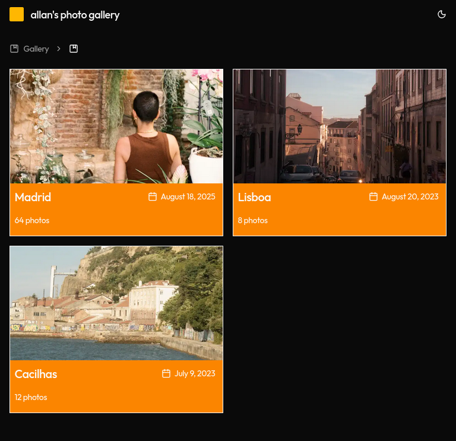
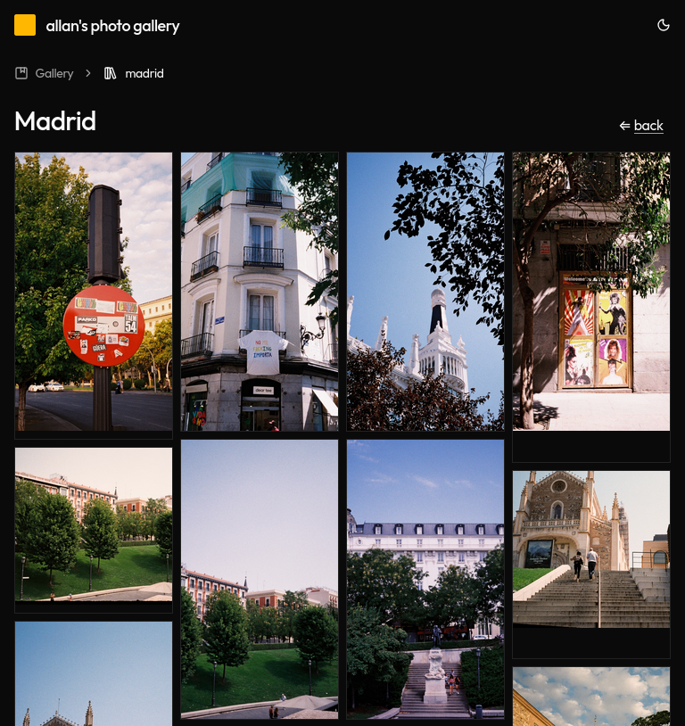

# astro-r2-gallery

> Building an Image Gallery with Astro and Cloudflare R2

> Cloudflare R2 + Astro's Content Layer is all the infrastructure your image gallery will ever need.

A personal photo gallery template built with [Astro](https://astro.build/) and [Cloudflare R2](https://developers.cloudflare.com/r2/). Photos are organized into albums, served directly from R2, and displayed in a [masonry grid](https://developer.mozilla.org/en-US/docs/Web/CSS/Guides/Grid_layout/Masonry_layout) with a fullscreen lightbox.

## Features

- **Album-based organization.** Define albums in a single `albums.toml` file. Each album maps to an R2 prefix and a URL route.
- **Masonry grid with lightbox.** Photos are distributed into columns and open in a fullscreen viewer powered by [Fancybox](https://fancyapps.com/fancybox/).
- **Optimized image delivery.** Photos are served as AVIF from R2 via a public custom domain, with Astro's `<Image />` handling lazy loading and sizing.
- **Incremental builds.** The R2 content loader skips photos that haven't changed since the last build, keeping rebuild times fast.
- **Dark mode.** Theme toggle included, persisted via `data-theme` attribute.




## Getting Started

### 1. Set up Cloudflare R2

Create an R2 bucket and an API token with read access. Enable a public custom domain on the bucket for image delivery.

### 2. Configure environment variables

Copy `.env.example` to `.env` and fill in your credentials:

```sh
R2_ACCESS_KEY_ID=
R2_SECRET_ACCESS_KEY=
R2_ENDPOINT=          # https://<account-id>.r2.cloudflarestorage.com
GALLERY_BUCKET=       # bucket name
R2_CUSTOM_DOMAIN=     # https://your-public-domain.com/
R2_DOMAIN=            # same as R2_CUSTOM_DOMAIN (used by Astro image optimization)
```

### 3. Define your albums

Edit `src/content/gallery/albums.toml`:

```toml
[[albums]]
name = "tokyo"
pubDate = "2024-11-01"

[[albums]]
name = "lisbon"
pubDate = "2024-08-15"
```

Each `name` is simultaneously the URL route (`/tokyo`), the R2 prefix (`tokyo/`), and the display label.

> R2 objects live in a flat namespace. What looks like a folder (`tokyo/`) is just a shared key prefix. This gallery uses each album name as that prefix, so `tokyo/01.avif` is the full key for photo `01` in the `tokyo` album.

### 4. Convert photos to AVIF

AVIF offers superior compression and image quality over WebP — smaller files for the same visual fidelity. Photos can be in any common format (PNG, JPG, JPEG, WebP, etc.). Convert them to AVIF before uploading:

```bash
#!/bin/bash
for i in *.{png,jpg,jpeg,webp}; do
  [ -f "$i" ] || continue
  ext="${i##*.}"
  avifenc -j 4 -s 10 "$i" "${i%.${ext}}.avif"
done
```

Requires [avifenc](https://github.com/AOMediaCodec/libavif). Adjust `-s` (speed/quality tradeoff, 0–10) to taste.

### 5. Add metadata (optional)

Before converting, embed copyright, description, and keywords into your originals using [exiftool](https://exiftool.org/):

```sh
exiftool -r \
  -Copyright="© 2025 Your Name" \
  -Description="shot in madrid" \
  -Keywords="travel,spain" \
  .
```

Run from the folder containing your originals. The `-r` flag processes subdirectories recursively.

### 6. Rename photos (optional)

After running exiftool, your originals are backed up as `*.jpg_original`. Rename them sequentially before converting:

```bash
#!/bin/bash
EXT="${1:-jpg_original}"
OUT="${2:-jpeg}"
counter=0

for file in *."${EXT}"; do
  [ -f "$file" ] || continue
  mv "$file" "$(printf "%02d" $counter).${OUT}"
  ((counter++))
done
```

Usage: `./rename_files.sh` (defaults to `jpg_original` → `jpeg`) or `./rename_files.sh png png` for any other format.

### 7. Upload to R2

Export your credentials, then run the upload script. `AWS_ACCESS_KEY_ID` and `AWS_SECRET_ACCESS_KEY` map to `R2_ACCESS_KEY_ID` and `R2_SECRET_ACCESS_KEY` from your `.env`:

```sh
export AWS_ACCESS_KEY_ID=      # same as R2_ACCESS_KEY_ID
export AWS_SECRET_ACCESS_KEY=  # same as R2_SECRET_ACCESS_KEY
export R2_ENDPOINT=            # https://<account-id>.r2.cloudflarestorage.com
```

```bash
#!/bin/bash
for file in *.avif; do
  base="${file%.avif}"
  key="${base//-//}.avif"

  aws s3 cp "$file" "s3://gallery/$key" \
    --endpoint-url "$R2_ENDPOINT"
done
```

Run this from inside each album folder. The script maps filenames like `tokyo-01.avif` to the R2 key `tokyo/01.avif`.

### 8. Run the dev server

```sh
npm install
npm run dev
```

## Stack

- [Astro](https://astro.build/)
- [Cloudflare R2](https://developers.cloudflare.com/r2/) via [aws4fetch](https://github.com/mhart/aws4fetch)
- [Tailwind CSS v4](https://tailwindcss.com/)
- [Fancybox](https://fancyapps.com/fancybox/)
- [Outfit](https://fonts.google.com/specimen/Outfit) typeface
